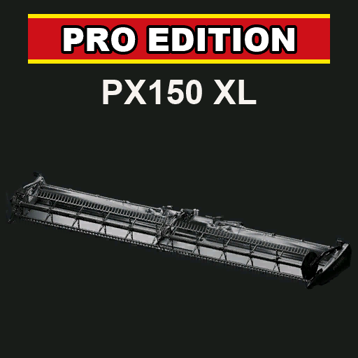

# ModHub upload: PX150 XL Windrower Pro Edition

What to enter in the GIANTS ModHub upload form for this mod. Each text box below has a copy button on GitHub.



**Mod Icon (512x512):** [`icon_512.png`](icon_512.png)

| Field | Value |
|-------|-------|
| Title English | PX150 XL Windrower Pro Edition |
| Title German | PX150 XL Schwadschneidwerk Pro Edition |
| Title French | PX150 XL Coupe andaineuse Pro Edition |
| Version | `2` `8` `2` `1` |
| Author | DTM Mods, PropaineX |
| Manufacturer | MacDon |
| Category 1 | Combine Harvesting > Special Headers |
| Category 2 | Combine Harvesting > Windrower |
| Category 3 | Not Set |

## Title English
```text
PX150 XL Windrower Pro Edition
```

## Title German
```text
PX150 XL Schwadschneidwerk Pro Edition
```

## Title French
```text
PX150 XL Coupe andaineuse Pro Edition
```

## Description English
```text
Category: Special Headers
Price: $144,500
Required power: 61 hp (45 kW)
Working width: 15.2 m
Working speed: 10 kph

PX150 XL Windrower Pro Edition: a 15.2 m grain windrower header for the MacDon M1240.
Cuts every crop the map lists for grain headers. Crops with a map swath are laid as swaths; rye and triticale get their own swaths coloured like their grain; other grain header crops are laid as a grain row. Pick up with the MacDon PW8.
Requires the MacDon Pack (DLC).
```

## Description German
```text
Shopkategorie: Sonderschneidwerke
Preis: 144.500 €
Benötigte Leistung: 61 PS (45 kW)
Arbeitsbreite: 15,2 m
Arbeitsgeschwindigkeit: 10 km/h

PX150 XL Schwadschneidwerk Pro Edition: ein 15,2 m Getreideschneidwerk fuer den MacDon M1240.
Schneidet alle Fruechte, die die Karte fuer Getreideschneidwerke vorsieht. Fruechte mit Kartenschwad werden als Schwad abgelegt, Roggen und Triticale als eigene Schwade in Kornfarbe, andere als Kornreihe. Aufnahme mit dem MacDon PW8.
Benoetigt das MacDon Pack (DLC).
```

## Description French
```text
Catégorie : Coupes spéciales
Prix : 144 500 $
Puissance requise : 61 ch (45 kW)
Largeur de travail : 15,2 m
Vitesse de travail : 10 km/h

PX150 XL Coupe andaineuse Pro Edition : une coupe andaineuse à céréales de 15,2 m pour la MacDon M1240.
Coupe toutes les cultures que la carte attribue aux coupes à céréales. Les cultures qui ont un andain sur la carte sont déposées en andain ; le seigle et le triticale ont leurs propres andains, de la couleur de leur grain ; les autres cultures pour coupe à céréales sont déposées en ligne de grain. Ramassage avec la MacDon PW8.
Nécessite le MacDon Pack (DLC).
```

## Screenshots

Upload the 4 images in [`screenshots/`](screenshots/) (1600x900, unedited in-game shots) in this order: [`1.jpg`](screenshots/1.jpg), [`2.jpg`](screenshots/2.jpg), [`3.jpg`](screenshots/3.jpg), [`4.jpg`](screenshots/4.jpg).

## Before uploading

- Brand: the store item uses the mod's own brand "PropaineX" (`brand_propainex.dds`), and the model is the base-game John Deere HD50F header, edited and relettered PX150XL. ModHub only accepts brands GIANTS has licensed, so a made-up brand will most likely be rejected; decide on John Deere (the model it is built from) or Lizard, and whether the PropaineX lettering on the model can stay.
- The zip ships copies of base-game files the mod never loads (the model reads them from the game's `$data`): `headerHD50F.xml`, `headerHD50F.i3d` and `.i3d.shapes`, `store_headerHD50F.dds`, the eight `headerHD50F*.dds` and `beltXArray.dds` in the root, and all of `textures/johnDeere/`. ModHub does not accept redistributed game files; leave them out of the upload zip (e.g. with a `.modignore`).
- Translations in the mod itself: no French at all; the German modDesc description is out of date (it has untranslated English lines for 2.1.4.0/2.1.5.0 and misses 2.8.1.0), and the shop function text and the "Turn on/off header" texts are English only.
