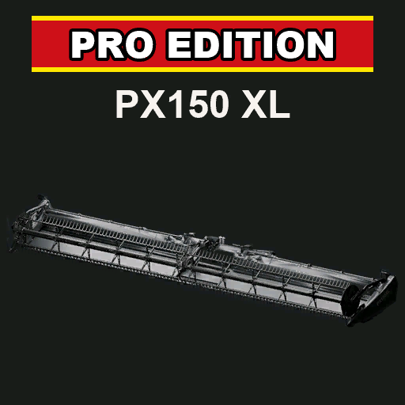

# ModHub upload: PX150 XL Windrower Pro Edition

What to enter in the GIANTS ModHub upload form for this mod. Each text box below has a copy button on GitHub.



**Mod Icon (512x512):** [`icon_512.png`](icon_512.png)

| Field | Value |
|-------|-------|
| Title English | PX150 XL Windrower Pro Edition |
| Title German | PX150 XL Schwadschneidwerk Pro Edition |
| Title French | PX150 XL Coupe andaineuse Pro Edition |
| Version | `2` `8` `2` `1` |
| Author | DTM Mods, PropaineX |
| Manufacturer | PropaineX |
| Category 1 | Combine Harvesting > Special Headers |
| Category 2 | Combine Harvesting > Windrower |
| Category 3 | Not Set |

## Title English
```text
PX150 XL Windrower Pro Edition
```

## Title German
```text
PX150 XL Schwadschneidwerk Pro Edition
```

## Title French
```text
PX150 XL Coupe andaineuse Pro Edition
```

## Description English
```text
The PX150 XL Windrower Pro Edition is a 15.2 m grain windrower header for the MacDon M1240 from the MacDon Pack. Cut your crop into swaths with it and pick them up later with the MacDon PW8.

- Cuts every crop the map lists for grain headers, on any map
- Crops with a map swath are laid as that swath; rye and triticale get their own swaths, coloured like their grain
- Other grain header crops (field grass, lentils, peas, beans, sorghum and more) are laid as a grain row that matches the crop's grain yield
- 25% more yield on alfalfa, clover and field grass (alfalfa and clover only on maps that let a windrower cut them, e.g. NF Marsch); every other crop keeps the map's normal yield
- Sits low when lowered (0.30 m) for a clean cut and keeps cutting over small bumps
- Shop option "Accessories and trim" (250): end-cap stickers and mounting bracket in any colour, MacDon Red by default
- Price: 144,500, working width 15.2 m, 10 km/h, 45 kW required, 2.45 t

Requires the MacDon Pack. Shop: Special Headers.

Changelog 2.8.2.0:
- Yield bonus raised to 25% and now also applies to field grass (alfalfa, clover and field grass).
```

## Description German
```text
Das PX150 XL Schwadschneidwerk Pro Edition ist ein 15,2 m breites Getreide-Schwadschneidwerk für den MacDon M1240 aus dem MacDon Pack. Damit legst du die Ernte in Schwaden ab und nimmst sie später mit der MacDon PW8 auf.

- Schneidet auf jeder Karte alle Früchte, die die Karte für Getreideschneidwerke vorsieht
- Früchte mit Kartenschwad werden als dieser Schwad abgelegt; Roggen und Triticale bekommen eigene Schwade in der Farbe ihres Korns
- Andere Früchte für Getreideschneidwerke (Feldgras, Linsen, Erbsen, Bohnen, Sorghum und weitere) werden als Kornreihe abgelegt, passend zum Kornertrag der Frucht
- 25 % mehr Ertrag bei Luzerne, Klee und Feldgras (Luzerne und Klee nur auf Karten, auf denen ein Schwadmäher sie schneiden darf, z. B. NF Marsch); alle anderen Früchte bringen den normalen Kartenertrag
- Liegt abgesenkt tief (0,30 m) für einen sauberen Schnitt und schneidet auch über kleine Bodenwellen weiter
- Shop-Option "Zubehör und Zierleisten" (250): Endkappenaufkleber und Anbaurahmen in jeder Farbe, standardmäßig MacDon Rot
- Preis: 144.500, Arbeitsbreite 15,2 m, 10 km/h, Leistungsbedarf 45 kW, 2,45 t

Benötigt das MacDon Pack. Shop: Sonderschneidwerke.

Changelog 2.8.2.0:
- Ertragsbonus auf 25 % erhöht, gilt jetzt auch für Feldgras (Luzerne, Klee und Feldgras).
```

## Description French
```text
La PX150 XL Coupe andaineuse Pro Edition est une coupe andaineuse à céréales de 15,2 m pour la MacDon M1240 du MacDon Pack. Elle dépose la récolte en andains, que vous ramassez ensuite avec la MacDon PW8.

- Coupe toutes les cultures que la carte attribue aux coupes à céréales, sur n'importe quelle carte
- Les cultures qui ont un andain sur la carte sont déposées en andain ; le seigle et le triticale ont leurs propres andains, de la couleur de leur grain
- Les autres cultures pour coupe à céréales (herbe, lentilles, pois, haricots, sorgho, etc.) sont déposées en ligne de grain, selon leur rendement en grain
- 25 % de rendement en plus sur la luzerne, le trèfle et l'herbe (luzerne et trèfle seulement sur les cartes où une andaineuse peut les couper, p. ex. NF Marsch) ; les autres cultures gardent le rendement normal de la carte
- Très basse en position abaissée (0,30 m) pour une coupe nette, continue de couper sur les petites bosses
- Option en boutique "Accessoires et finitions" (250) : autocollants des embouts et support d'attelage dans toutes les couleurs, rouge MacDon par défaut
- Prix : 144 500, largeur de travail 15,2 m, 10 km/h, puissance requise 45 kW, 2,45 t

Nécessite le MacDon Pack. Boutique : Coupes spéciales.

Changelog 2.8.2.0 :
- Bonus de rendement porté à 25 %, s'applique désormais aussi à l'herbe (luzerne, trèfle et herbe).
```

## Before uploading

- Brand: the store item uses the mod's own brand "PropaineX" (`brand_propainex.dds`), and the model is the base-game John Deere HD50F header, edited and relettered PX150XL. ModHub only accepts brands GIANTS has licensed, so a made-up brand will most likely be rejected; decide on John Deere (the model it is built from) or Lizard, and whether the PropaineX lettering on the model can stay.
- The zip ships copies of base-game files the mod never loads (the model reads them from the game's `$data`): `headerHD50F.xml`, `headerHD50F.i3d` and `.i3d.shapes`, `store_headerHD50F.dds`, the eight `headerHD50F*.dds` and `beltXArray.dds` in the root, and all of `textures/johnDeere/`. ModHub does not accept redistributed game files; leave them out of the upload zip (e.g. with a `.modignore`).
- Translations in the mod itself: no French at all; the German modDesc description is out of date (it has untranslated English lines for 2.1.4.0/2.1.5.0 and misses 2.8.1.0), and the shop function text and the "Turn on/off header" texts are English only.
